# Runtime Flows — Jharkhand Eco & Cultural Tourism Backend

How a request, a booking, a payment and an event actually move through the system. Each flow names the module,
the guarantees it gives and the decision that explains it (IDs refer to [DECISIONS.md](DECISIONS.md)).
Structure and module boundaries: [ARCHITECTURE.md](ARCHITECTURE.md). Diagrams are Mermaid (rendered by GitHub
and VS Code).

**Contents**
1. [System context](#1-system-context)
2. [Request lifecycle](#2-request-lifecycle)
3. [Authentication](#3-authentication)
4. [Authorisation and partner context](#4-authorisation-and-partner-context)
5. [Partner onboarding and supply moderation](#5-partner-onboarding-and-supply-moderation)
6. [Media upload](#6-media-upload)
7. [Booking](#7-booking)
8. [Payment](#8-payment)
9. [Cancellation and refunds](#9-cancellation-and-refunds)
10. [Events, outbox and background jobs](#10-events-outbox-and-background-jobs)
11. [Notifications](#11-notifications)
12. [Trips, favorites and reviews](#12-trips-favorites-and-reviews)
13. [Reporting, settings and audit](#13-reporting-settings-and-audit)
14. [Errors](#14-errors)
15. [Deployment topology](#15-deployment-topology)

---

## 1. System context

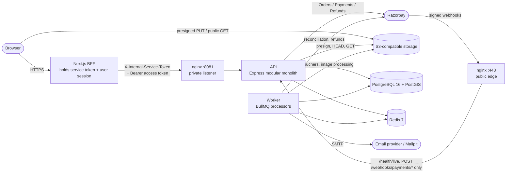

- Browsers never call the API directly. The BFF is the only client; it keeps the service token server-side (C12, P10).
- The public edge exposes only liveness and payment webhooks (C1, J3). Everything else goes through the private
  listener, reachable only from the BFF's Docker network in production (J2).
- The API and the worker run the same image. The API writes outbox rows; only the worker talks to BullMQ (G1).

---

## 2. Request lifecycle

Every route is a declarative definition (`modules/*/**.routes.js`) that `core/http/routes.js` turns into the Express
middleware chain below, and into OpenAPI and the Postman collection (P2, K1).

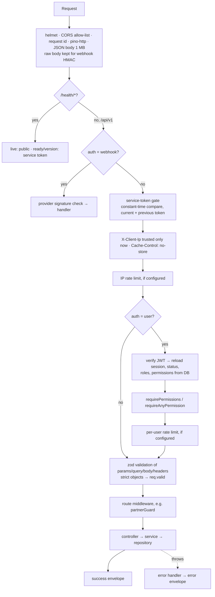

- Validation failures stop the request before any service code runs (422, P3).
- A service runs its writes in one transaction (`withTransaction`, with retry on serialisation/deadlock). Admin
  mutations use `auditedTransaction`, so the audit row commits with the change or not at all (A12).
- `requestContext(req)` gives services the actor, roles, permissions, partner context, client IP and request id.

---

## 3. Authentication

### Registration and email verification

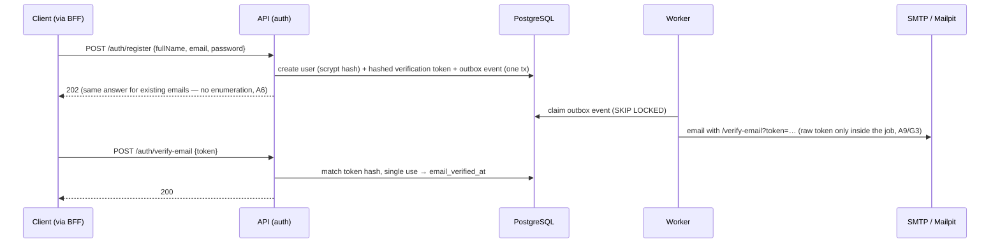

### Login, refresh rotation and reuse detection

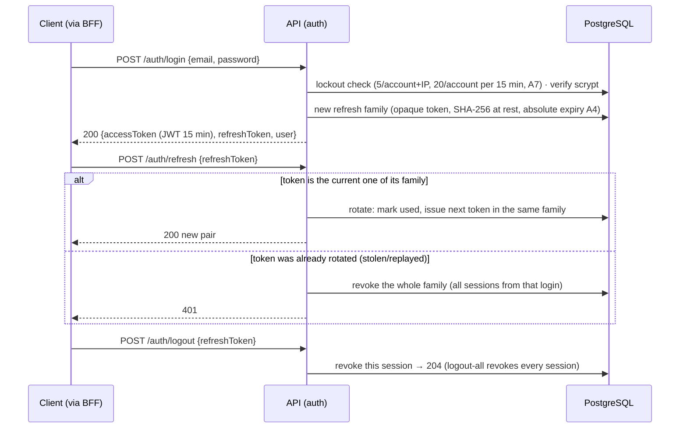

- Every authenticated request reloads session and permissions, so logout, suspension and role changes apply at
  once without a token blocklist (A3).
- Password reset (`forgot-password` → email → `reset-password`) revokes all sessions; change-password keeps the
  current session and revokes the others.

---

## 4. Authorisation and partner context

1. **Role permissions** — 6 roles, permissions granted per role (migration 0004, A10). Routes declare
   `permissions` (all required) or `anyPermissions`.
2. **Ownership** — `*.own` routes filter by the caller; another user's resource answers **404**, not 403, so ids
   cannot be probed (H1).
3. **Partner context** — every `/partners/me/*` route runs `partnerGuard`:

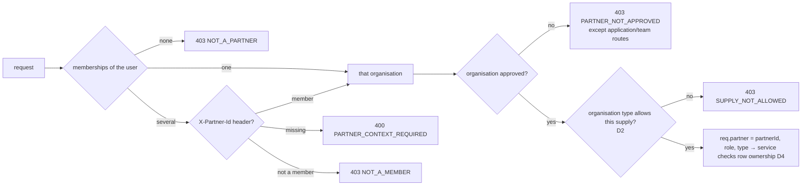

---

## 5. Partner onboarding and supply moderation

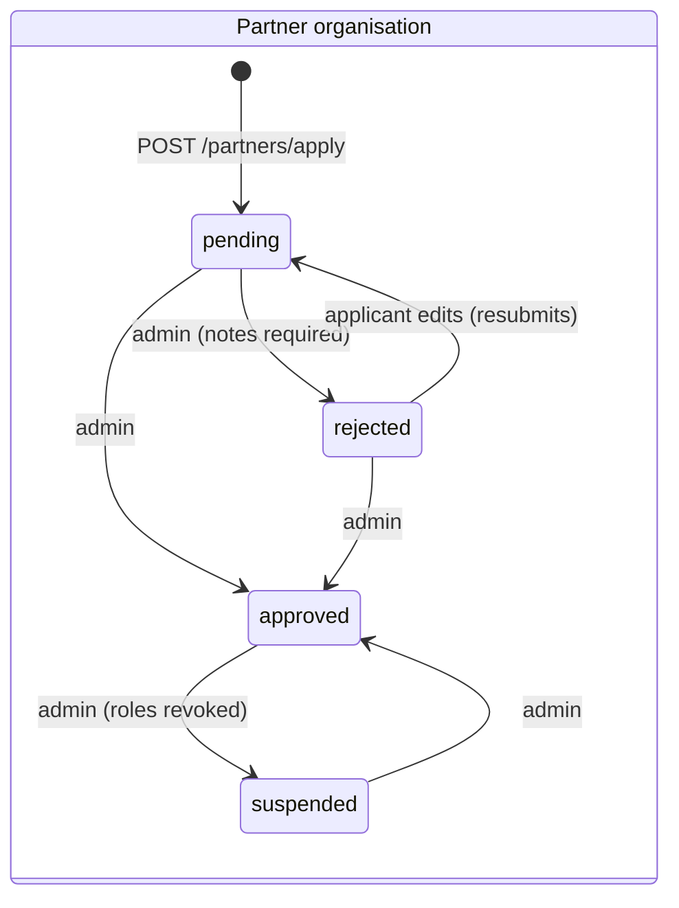

- Approval grants every member the global role for the organisation's type (hotel_partner / guide /
  package_provider); every status or membership change re-syncs roles (D2). Identity fields lock after approval (D3).
- Admins cannot review their own organisation (`SELF_REVIEW_FORBIDDEN`, D5).

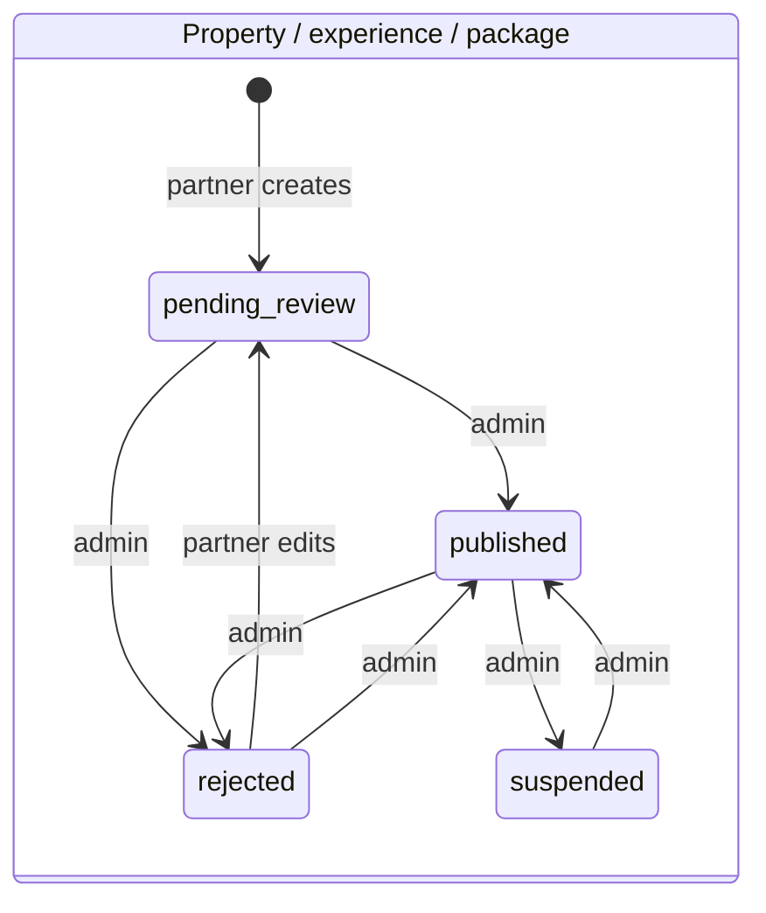

- **Public** means published **and** the partner organisation is approved (D5). Suspending a partner hides all
  of its supply at once.
- Guides follow verification instead: unverified → pending (document submitted) → verified/rejected; public =
  active + verified + approved partner (D6).

---

## 6. Media upload

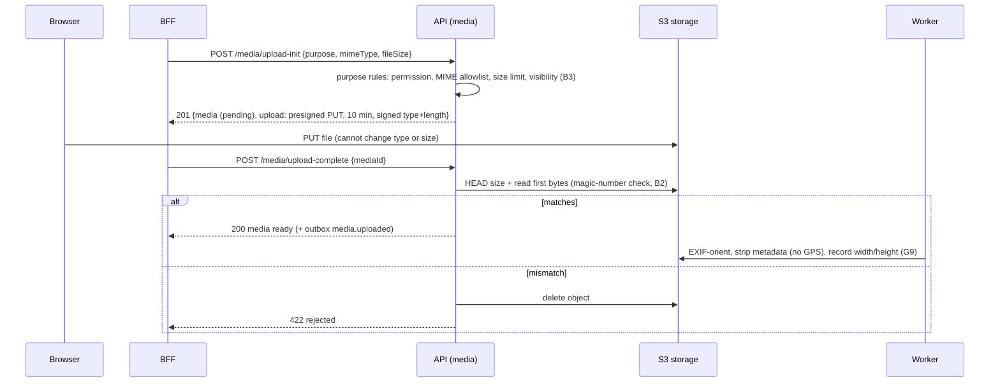

Public images are served directly from the bucket/CDN URL; private documents only through 5-minute signed URLs
to the uploader or `media.manage` (B3). Media referenced anywhere cannot be deleted (409 `MEDIA_IN_USE`, B4).

---

## 7. Booking

### Quote and create

```mermaid
sequenceDiagram
  participant C as Traveller (via BFF)
  participant B as API (bookings)
  participant Sup as Supply module (properties/guides/experiences/packages)
  participant DB as PostgreSQL
  C->>B: POST /bookings/quote {itemType, resourceId, dates/party}
  B->>Sup: price + indicative availability (no reservation)
  B-->>C: 200 quote (decimal strings, snapshot of policy)
  C->>B: POST /bookings + Idempotency-Key
  B->>DB: idempotency record (scope bookings.create:userId, E7)
  B->>DB: BEGIN
  B->>Sup: prepareBooking(lock: supply row FOR UPDATE, E5)
  Sup->>DB: capacity − active allocations (confirmed + unexpired held)
  alt instant mode and capacity available
    B->>DB: booking pending_payment + inventory_hold held (expires in 15 min)
  else request mode
    B->>DB: booking requested (no hold; partner has 24 h)
  else no capacity
    B-->>C: 409 INSUFFICIENT_AVAILABILITY
  end
  B->>DB: snapshot (prices, policy, request) + outbox booking.created/requested · COMMIT
  B-->>C: 201 booking (replay with same key → same booking, Idempotent-Replay: true)
```

Concurrency guarantee: six buyers racing for the last room produce exactly one booking. Guide time ranges are
additionally protected by a GiST exclusion constraint on holds (E5, verified in tests).

### Booking states

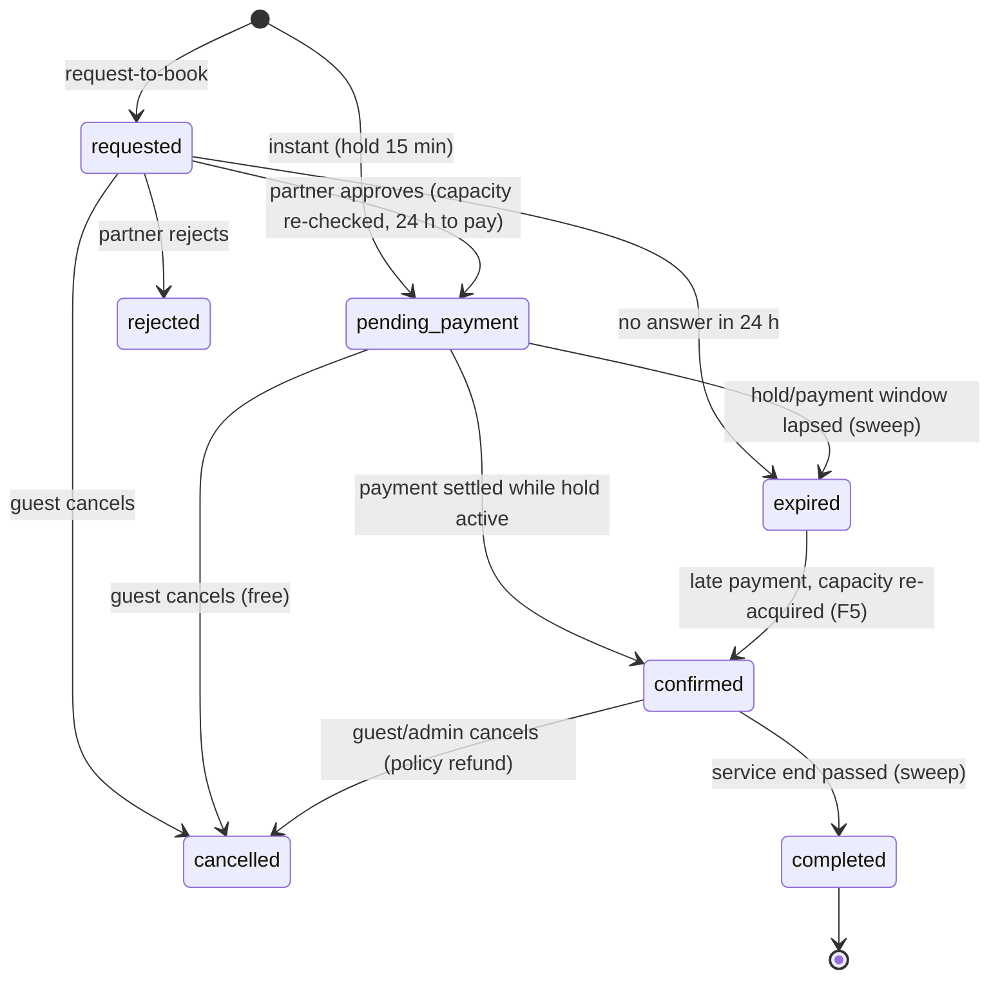

- Transitions are enforced by one table in `bookings.service.js`; anything else is 409 `INVALID_BOOKING_STATE`.
- A lapsed hold stops counting towards capacity immediately; the 30 s sweep only records the state change and
  emits events (E4).
- Every transition is written to `booking_status_history` and emits an outbox event.

---

## 8. Payment

```mermaid
sequenceDiagram
  participant C as Traveller (via BFF)
  participant A as API (payments)
  participant R as Razorpay
  participant Wk as Worker
  C->>A: POST /bookings/:id/payment-order + Idempotency-Key
  A->>R: create order (amount in paise, receipt = order id)
  A-->>C: 201 {checkout: keyId, orderId, amount}
  C->>R: Razorpay Checkout (card/UPI)
  R-->>C: {order_id, payment_id, signature}
  C->>A: POST /payments/verify
  A->>A: HMAC(order_id|payment_id) must match (F2)
  A->>R: fetch payment → order, amount, currency must match; capture if authorized
  A->>A: settlePayment (order row lock, idempotent, F3)
  A-->>C: 200 {outcome: confirmed, bookingStatus, paymentStatus}
  R->>A: webhook payment.captured / order.paid (signed, persisted, deduped by event id, F4)
  A->>A: same settlePayment → no second confirmation
  Wk->>R: reconciliation for orders with no callback/webhook (F8)
```

`settlePayment` outcomes (exactly one captured transaction per payment):

| Situation | Result |
|-----------|--------|
| Booking `pending_payment`, hold active | `confirmed`, payment `paid`, outbox `booking.confirmed` |
| Hold already lapsed, capacity still free | re-acquired under the supply lock → `confirmed` at the paid price (F5) |
| Hold lapsed, capacity gone | full `late_payment` refund — never overbooks (F5) |
| Booking already confirmed by another payment | `duplicate_payment` refund; booking stays paid (F5) |
| Same payment seen again (callback + webhook + reconciliation) | acknowledged, no side effects (F3) |

Without Razorpay keys (development default) payment routes answer `503 PAYMENTS_NOT_CONFIGURED` (F1).

---

## 9. Cancellation and refunds

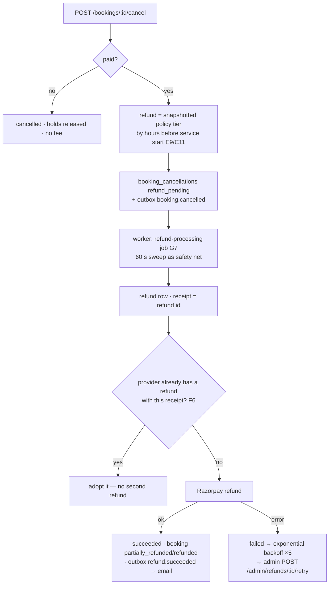

Admins can also issue manual partial refunds (`refunds.initiate`, Idempotency-Key, audited); total refunds can never
exceed the captured amount because refunds lock the captured transaction (F6).

---

## 10. Events, outbox and background jobs

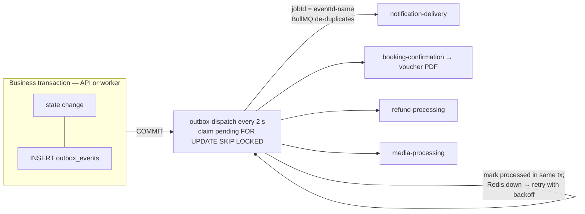

| Event | Jobs |
|-------|------|
| `auth.*`, `booking.*`, `refund.*`, `partner.status_changed` | `notification-delivery` → in-app + email |
| `booking.confirmed` | also `booking-confirmation` → voucher PDF (G8) |
| `booking.cancelled` with a refund due | also `refund-processing` (G7) |
| `media.uploaded` | `media-processing` (G9) |

Scheduled jobs (one firing per interval across all worker replicas, G2):

| Every | Job |
|-------|-----|
| 2 s | outbox dispatch |
| 30 s | booking sweep: expire lapsed holds/requests, complete finished services |
| 60 s | payment reconciliation · refund sweep |
| 1 h | housekeeping: stale uploads, old login attempts/tokens/idempotency records/outbox rows (G10) |

Guarantees: an event committed while the worker or Redis is down is delivered after restart (verified); every
consumer is idempotent, so at-least-once delivery never duplicates an email, voucher or refund (P9).

---

## 11. Notifications

1. The notifier maps the event to templates per channel (`in_app`, `email`) and recipients (guest, partner
   members, admins).
2. Each message gets a `dedupe_key` (event, template, channel, recipient) — a re-run cannot send it twice (G4).
3. Templates are plain text with `{{placeholders}}`; values are HTML-escaped for email; inactive templates are
   skipped; admins edit them via `/admin/notification-templates` (audited, G5).
4. Email bodies are never stored (they may contain one-time links); deliveries record status and attempts.
5. Users read their inbox via `/notifications` (unread count, mark read, read-all).

---

## 12. Trips, favorites and reviews

- **Trips** are private plans — never reservations (H1). Creating a dated trip creates one day per date; changing
  dates re-dates days; stops can be reordered across days in one atomic request (deferred unique order, H3).
- **Favorites** save any publicly listed destination, property, guide, experience or package; saving twice is a
  no-op (200), and an item that later goes private stays listed as `available: false` (H4).
- **Reviews**:

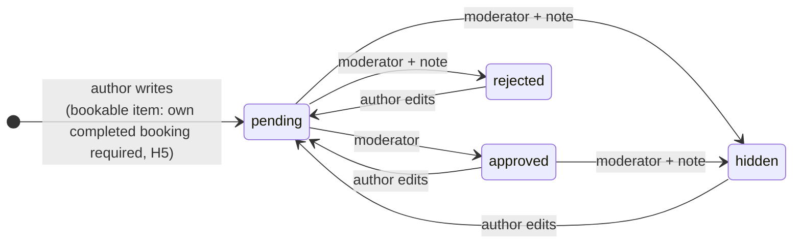

An author may delete their own review in any state; any edit sends it back to `pending`.

Only approved reviews are public, with the rating summary in `meta.rating`; authors see every status and the
moderator's note in `GET /users/me/reviews` (H6, I9).

---

## 13. Reporting, settings and audit

- **Reports** (`modules/analytics`) are read-only SQL projections over the transactional tables (I1). Ranges are
  local dates (default last 30 days, max 366), with empty buckets filled (I2). Revenue = captured − refunded by the
  date money moved; gross until O2 (I3). Partner reports are always scoped to the caller's organisation (I5).
- **Settings** (`/admin/settings`): approved keys only, validated per key, atomic, audited per changed key; the
  API's 30 s settings cache is cleared at once on this instance (I6). New values apply to bookings created afterwards.
- **Audit**: every admin mutation writes `audit_logs` in the same transaction; the table is append-only by trigger
  and by privilege (A12, J1). `/admin/audit-logs` searches by actor, entity, action prefix and date (I7).

---

## 14. Errors

| Status | When | Example codes |
|--------|------|---------------|
| 400 | malformed JSON / input type, missing partner context | `INVALID_JSON`, `INVALID_INPUT`, `PARTNER_CONTEXT_REQUIRED` |
| 401 | missing/invalid service token or user token, revoked session | `SERVICE_TOKEN_MISSING`, `SERVICE_TOKEN_INVALID`, `AUTH_REQUIRED`, `INVALID_TOKEN`, `SESSION_REVOKED` |
| 403 | authenticated but not permitted | `FORBIDDEN`, `EMAIL_NOT_VERIFIED`, `ACCOUNT_SUSPENDED`, `NOT_A_PARTNER`, `SUPPLY_NOT_ALLOWED` |
| 404 | not found **or not yours** | `NOT_FOUND`, `BOOKING_NOT_FOUND`, `TRIP_NOT_FOUND`, `ROUTE_NOT_FOUND` |
| 409 | state, inventory or idempotency conflict | `INSUFFICIENT_AVAILABILITY`, `INVALID_BOOKING_STATE`, `HOLD_EXPIRED`, `REVIEW_EXISTS` |
| 413 | body too large | `PAYLOAD_TOO_LARGE` |
| 422 | validation / business rule on input | `VALIDATION_ERROR` (with `details[]`), `PUBLISH_REQUIREMENTS`, `BOOKING_NOT_REVIEWABLE` |
| 429 | rate limit / login lockout | `RATE_LIMITED`, `LOGIN_LOCKED` (with `Retry-After`) |
| 503 | dependency not configured / timeout | `PAYMENTS_NOT_CONFIGURED`, `TIMEOUT` |
| 500 | unexpected — logged with the request id, never exposes internals | `INTERNAL_ERROR` |

Every error carries `requestId`; the same id is in the `X-Request-Id` response header and in every log line,
so one id traces a request across nginx, API and worker logs.

---

## 15. Deployment topology

| | Development (`docker-compose.yml`) | Production (`docker-compose.prod.yml`) |
|-|-------------------------------------|----------------------------------------|
| Public edge | nginx :8080 → `/health/live`, webhooks | nginx :443 TLS (+ :80 ACME/redirect) |
| BFF / API access | nginx :8081 on `127.0.0.1` | nginx :8081 on the `bff` Docker network only |
| Database role | schema owner | least-privilege runtime role (J1) |
| Storage / email | SeaweedFS, Mailpit (localhost UIs) | managed S3, SMTP provider |
| API docs | Swagger UI at `/docs/` on :8081 | not served |
| Hardening | — | read-only FS, non-root, no capabilities, CPU/memory limits, log rotation (J2) |

Operations — releases, backups, restore drill, secret rotation — are in
[../operations/DEPLOYMENT.md](../operations/DEPLOYMENT.md). Testing every route by hand or as runnable scenarios:
[../api/POSTMAN.md](../api/POSTMAN.md).
