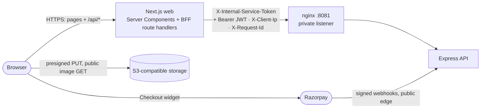
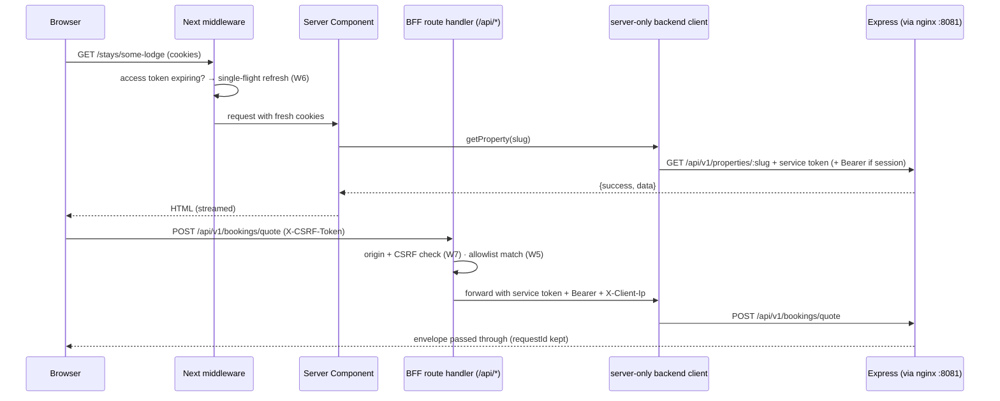
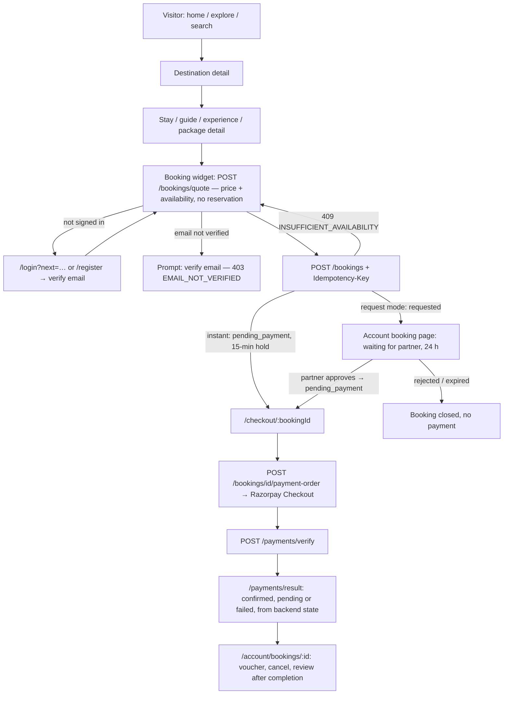
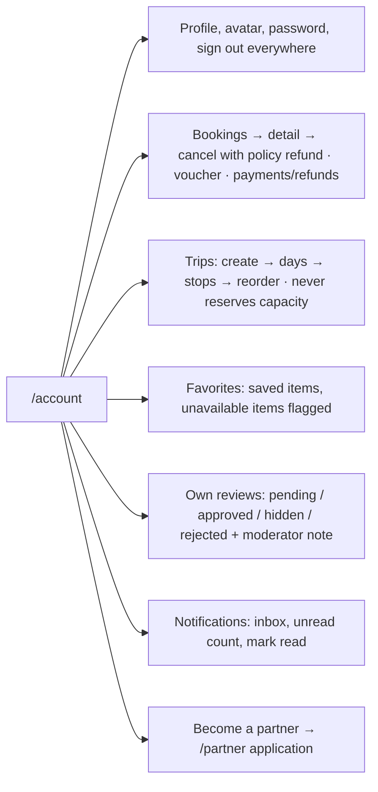
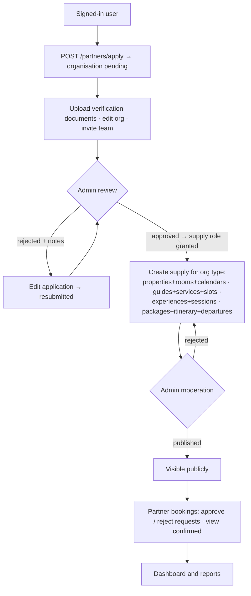
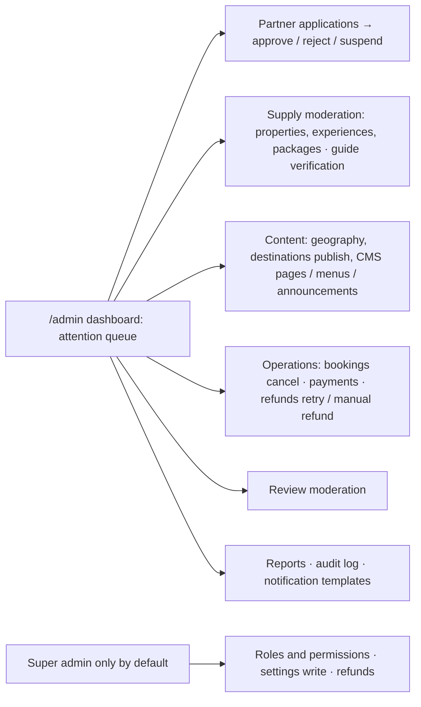
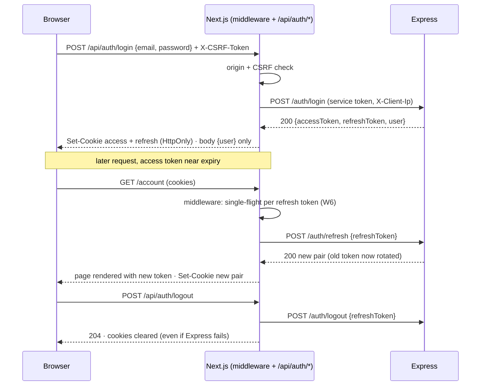

# Frontend High-Level Design — Jharkhand Eco & Cultural Tourism

Scope: the Next.js web application and its server-side BFF for visitors, tourists, partners (hotel, guide,
operator) and administrators. Inputs: the backend technical report
([../../docs/backend/](../../docs/backend/)), the generated contract [../../docs/api/openapi.json](../../docs/api/openapi.json)
(242 operations) and backend decisions/flows in [../../docs/architecture/](../../docs/architecture/).
Decisions are cited by id from [DECISIONS.md](DECISIONS.md) (W…) and the backend record (A…–K…, P…).

## 1. Goals and non-goals

**Goals**
- Public discovery of Jharkhand destinations, districts, culture and nature, CMS-driven homepage and pages, search.
- Browse and book stays, guides, experiences and packages, then pay through Razorpay.
- Tourist account: profile, bookings, trips, favourites, reviews, notifications.
- Partner portal and admin console covering every partner/admin route in the contract.
- Keep every secret and token server-side; the backend stays the single authority for rules (W3, W4).

**Non-goals (v1)** — anything outside the backend report (§1.2): flights, rail, taxis, AI itineraries, chat,
social features, wallets, native-app APIs. No TypeScript, Redux, GraphQL, microfrontends, direct database
access, or Next.js-side business logic.

## 2. System context



- The browser talks only to the Next.js origin (pages and `/api/*`), plus storage for uploads/images and
  Razorpay Checkout. It never reaches Express (backend FLOW §1).
- `web` reaches the API only through nginx's private listener: `http://nginx:8081` in development on the
  `edge` network; the `bff` network in production (W23, backend J2).

## 3. Request paths



| Path | Used for | Auth sent to Express |
|------|----------|----------------------|
| Server Component → backend client | First render of public and signed-in pages | service token; Bearer when a session cookie exists |
| Browser → `/api/v1/*` → backend client | Interactive reads/mutations (TanStack Query) | service token + Bearer; CSRF + origin checked first |
| Browser → `/api/auth/*` (dedicated) | login, logout, logout-all, session read | handler manages cookies; tokens never in the response body |
| Middleware → `/auth/refresh` | Token rotation before render or forwarding | service token + refresh token in body |

## 4. Rendering strategy (W9)

| Surface | Rendering | Caching |
|---------|-----------|---------|
| Home, CMS pages, destinations, districts, categories | Server Components | revalidate (default 60 s); public data only |
| Supply listings and detail (stays, guides, experiences, packages) | Server Components + client islands (filters, booking widget) | content revalidated; availability and quotes always live |
| Search | Server-rendered results from URL params; client suggestions | `no-store` |
| Account, partner portal, admin console | Server layout gate + client data tables/forms | `no-store` |
| Checkout and payment result | Client island (Razorpay) + server-rendered booking state | `no-store` |

## 5. Route map

The frozen route map, with the file, gate, rendering mode and confirmed operations of every page, is
[SITEMAP.md](SITEMAP.md). The mapping of all 242 operations to pages is [API_MAPPING.md](API_MAPPING.md).

| Route group | URL prefix | Gate |
|-------------|------------|------|
| `(public)` | `/`, `/explore`, `/destinations`, `/districts`, `/stays`, `/guides`, `/experiences`, `/packages`, `/search`, `/pages` | none |
| `(auth)` | `/login`, `/register`, `/forgot-password`, `/reset-password`, `/verify-email` | signed-out for login/register |
| `(tourist)` | `/account/*` | session |
| `(booking)` | `/checkout/*`, `/payments/result` | session (+ verified email to pay) |
| `(partner)` | `/partner/*` | session + partner membership |
| `(admin)` | `/admin/*` | session + per-page permission |

The site uses `/stays` for the API's `properties` resource and keeps `[slug]` / `[id]` exactly as the API
does (backend C8: properties, experiences, packages and destinations by slug; guides by id).

## 5a. Roles and workflows

Personas follow Report §1: visitor, tourist, partner (hotel, guide, operator), admin and super admin. Every
step below calls a confirmed operation (SITEMAP.md); states come from backend FLOW.md.

### Visitor → tourist: discover, book and pay



### Tourist account



### Partner: onboarding to bookings



### Admin and super admin



## 5b. Contract status labels

Every frontend document separates what exists from what is proposed:

| Label | Meaning | Example |
|-------|---------|---------|
| **Confirmed** | Present in `docs/api/openapi.json` or verified in backend code | All 242 rows of API_MAPPING; rendered CMS shapes from `renderSections()` |
| **Proposed** | Frontend design awaiting the Phase 0 gate | Route files, component names, cookie names, BFF handlers, W decisions |
| **Gap** | Needed by a planned experience but not offered by the backend | G1–G6 in DECISIONS.md §4 |

## 6. Module structure

```
src/
  app/          route groups, layouts, thin page files, BFF route handlers under app/api/
  components/   ui, layout, navigation, forms, feedback, data-display, maps (props-driven, no data fetching)
  features/     auth, home, geography, destinations, search, properties, guides, experiences, packages,
                bookings, payments, tourist, trips, favorites, reviews, notifications, partners, admin
  cms/          sectionRegistry, sectionSchemas, SectionRenderer, sections/, editor/ (admin)
  lib/          bff (cookies, csrf, refresh, allowlist, proxy), api (server-only client), auth, permissions,
                validation, query, formatting, seo
  config/       env schemas (server / public), site config
  hooks/ providers/ tests/
```

Dependency direction: `app → features → components/lib`. `components/` never imports `features/` or
`lib/api`. `lib/api` and `lib/bff` are server-only (W2, W3).

## 7. Security model

| Asset | Where it lives | Never |
|-------|----------------|-------|
| Internal service token | `web` server env (Docker secret in production) | in client bundles, `NEXT_PUBLIC_*`, logs or responses |
| Access JWT, refresh token | HttpOnly cookies (W6) | in JS-readable storage, URLs or response bodies |
| CSRF token | non-HttpOnly cookie + header (W7) | accepted without a matching origin |
| Payment secrets | backend only | in the frontend at all; only the public Razorpay key id from the order response |

### Trust boundaries

| Boundary | Who is trusted | Check |
|----------|----------------|-------|
| Browser → `web` | nobody; every input untrusted | CSRF + origin on mutations (W7); session from HttpOnly cookies only |
| `web` → Express | the BFF as a service, not as a user | service token on every call; user identity only via the user's own JWT (Report §6) |
| Express | the authority | JWT, session, permissions, ownership re-checked per request (backend A3, D4) |

### Session flows (BFF side; backend side in FLOW.md §3)



Other controls: CSP with nonces (W19), allowlisted BFF forwarding (W5), header stripping (W8), no CMS raw HTML
(W15), presigned uploads only (W16). Backend-enforced rules (RBAC, ownership, booking/payment integrity) are not
duplicated, only reflected (W13).

## 8. Error and state handling

- The backend envelope `{ success:false, error:{ code, message, details?, requestId } }` is passed to the
  browser unchanged; UI branches on `error.code` (backend P4; codes in FLOW §14).
- 401 from a user route → session cleared → redirect to `/login?next=`. 403 → permission page. 404 → `not-found`.
  409 → conflict message (e.g. availability changed: re-quote). 422 → field errors. 429 → `Retry-After`
  message. 503 `PAYMENTS_NOT_CONFIGURED` → explicit unavailable state (W17).
- Every page has real loading, empty and error states (W22); `error.jsx` shows the `requestId`.

## 9. Deployment

| | Development | Production |
|-|-------------|------------|
| Service | `web` in root `docker-compose.yml`, `127.0.0.1:3000` | `web` in `docker-compose.prod.yml`, behind the TLS edge |
| API access | `http://nginx:8081` over `edge` | `http://nginx:8081` over `bff` |
| Image | `dev` target, bind mount, polling watch | `prod` target, standalone output, non-root, read-only FS |
| Public exposure | localhost only | nginx edge routes `/` to `web` (Phase 10 change to `prod.conf`) |

## 10. Delivery phases

The phases, their exit gates and current status are tracked in
[IMPLEMENTATION_STATUS.md](IMPLEMENTATION_STATUS.md). The rule is the backend's: one phase at a time, and the
next phase starts only after explicit owner approval.
